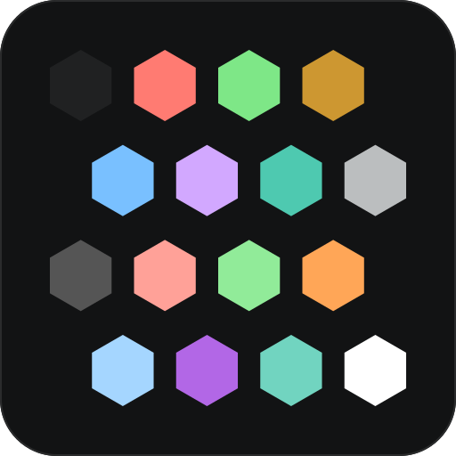

<p align="center">
  
</p>

# code-2026 — tmux

A tmux theme for the [code-2026](https://github.com/code-2026-theme) color scheme family, ported from VS Code's
**Dark Modern 2026**: red keywords, purple functions, teal types and light-blue strings.

## The code-2026 family

| Target | Repository | |
| --- | --- | --- |
| Neovim | [code-2026-theme/nvim](https://github.com/code-2026-theme/nvim) | colorscheme plugin |
| Ghostty | [code-2026-theme/ghostty](https://github.com/code-2026-theme/ghostty) | terminal theme |
| kitty | [code-2026-theme/kitty](https://github.com/code-2026-theme/kitty) | terminal theme |
| Xcode | [code-2026-theme/xcode](https://github.com/code-2026-theme/xcode) | editor theme |
| Obsidian | [code-2026-theme/obsidian](https://github.com/code-2026-theme/obsidian) | app theme |
| Yazi | [code-2026-theme/yazi](https://github.com/code-2026-theme/yazi) | file manager |
| Starship | [code-2026-theme/starship](https://github.com/code-2026-theme/starship) | shell prompt |
| tmux | [code-2026-theme/tmux](https://github.com/code-2026-theme/tmux) | **this repo** |

Every port shares one palette, so `:terminal` inside Neovim renders identically to the host
terminal.

## Requirements

- tmux 3.2+ (for `sync` flavor)
- Terminal with color scheme notification support (for `sync`):
  - Ghostty
  - kitty
  - WezTerm
  - iTerm2
  - Windows Terminal

## Installation

### Manual

```sh
mkdir -p ~/.config/tmux/plugins/code-2026
git clone https://github.com/code-2026-theme/tmux.git ~/.config/tmux/plugins/code-2026/tmux
```

Then add to your `~/.tmux.conf`:

```tmux
# Set options BEFORE sourcing the theme
set -g @code-2026-flavor "dark"

# Source the theme
source-file ~/.config/tmux/plugins/code-2026/tmux/code-2026_options.conf
source-file ~/.config/tmux/plugins/code-2026/tmux/code-2026_main.conf
```

Reload tmux:

```sh
tmux source-file ~/.tmux.conf
```

### With TPM

```tmux
set -g @plugin 'code-2026-theme/tmux'
```

Press `prefix + I` to install.

## Options

Set these **before** sourcing the theme:

### General

| Option | Values | Default | Description |
|--------|--------|---------|-------------|
| `@code-2026-flavor` | `dark`, `light`, `auto`, `sync` | `dark` | Color variant. `auto` detects macOS dark mode at startup. `sync` listens for OS changes live (tmux 3.2+). |
| `@code-2026-status-left` | comma-separated modules | `session,directory` | Left status modules |
| `@code-2026-status-right` | comma-separated modules | `application,cpu,ram,date_time` | Right status modules |
| `@code-2026-status-left-separator` | string | ` ` | Separator between left modules |
| `@code-2026-status-right-separator` | string | ` ` | Separator between right modules |
| `@code-2026-status-interval` | number | `5` | Status refresh interval (seconds) |
| `@code-2026-clock-mode-style` | `12`, `24` | `24` | Clock format |
| `@code-2026-date_time-format` | strftime format | `%Y-%m-%d %H:%M` | Date/time module format ([strftime(3)](https://developer.apple.com/library/documentation/Darwin/Reference/ManPages/man3/strftime.3.html)) |
| `@code-2026-pane-border-status` | `off`, `top`, `bottom` | `off` | Pane border status line |
| `@code-2026-window-format` | tmux format | `#I:#W` | Window title format (e.g. `#I:#W`, `#W`, `#I:#W#F`) |
| `@code-2026-window-current-format` | tmux format | `#I:#W` | Current window title format |
| `@code-2026-window-style` | style string | `""` | Regular window text style |
| `@code-2026-window-current-style` | style string | `bold` | Current window text style |

### Module Styles

Customize text style for each module (empty = default):

| Option | Values | Default | Description |
|--------|--------|---------|-------------|
| `@code-2026-session-style` | style string | `""` | Session text style |
| `@code-2026-directory-style` | style string | `""` | Directory text style |
| `@code-2026-date_time-style` | style string | `""` | Date/time text style |
| `@code-2026-application-style` | style string | `""` | Application text style |
| `@code-2026-cpu-style` | style string | `""` | CPU text style |
| `@code-2026-ram-style` | style string | `""` | RAM text style |

Style values: `bold`, `italic`, `dim`, `underscore`, `blink`, `reverse`, `strikethrough`. Combine with commas: `"bold,italic"`.

### Status Modules

Available modules for `@code-2026-status-left` and `@code-2026-status-right`:

| Module | Description | Requires |
|--------|-------------|----------|
| `session` | Session name | - |
| `directory` | Current window name | - |
| `date_time` | Date and time | - |
| `user` | Username (`whoami`) | - |
| `host` | Hostname | - |
| `application` | Current pane command | - |
| `cpu` | CPU percentage | [tmux-cpu](https://github.com/tmux-plugins/tmux-cpu) |
| `ram` | RAM percentage | [tmux-cpu](https://github.com/tmux-plugins/tmux-cpu) |

### Date/time Format

`@code-2026-date_time-format` takes any [strftime(3)](https://developer.apple.com/library/documentation/Darwin/Reference/ManPages/man3/strftime.3.html) specifier. The
theme expands it with tmux's `#{T:}` formatter, so each `%` token is replaced at
render time; everything else (spaces, `-`, `:`, `/`, …) is printed as-is.

| Specifier | Meaning | Example |
|-----------|---------|---------|
| `%Y` | 4-digit year | `2026` |
| `%m` | Month, zero-padded (01–12) | `10` |
| `%d` | Day, zero-padded (01–31) | `13` |
| `%H` | Hour, 24-h (00–23) | `13` |
| `%M` | Minute (00–59) | `24` |
| `%S` | Second (00–59) | `05` |
| `%I` | Hour, 12-h (01–12) | `01` |
| `%p` | AM/PM | `PM` |
| `%a` | Abbreviated weekday | `Tue` |
| `%A` | Full weekday | `Tuesday` |
| `%b` | Abbreviated month | `Oct` |
| `%B` | Full month | `October` |
| `%j` | Day of year (001–366) | `286` |
| `%T` | Shorthand for `%H:%M:%S` | `13:24:05` |
| `%F` | Shorthand for `%Y-%m-%d` | `2026-10-13` |

Ready-made formats:

| Value | Renders as |
|-------|------------|
| `%Y-%m-%d %H:%M` (default) | `2026-10-13 13:24` |
| `%H:%M` | `13:24` |
| `%I:%M %p` | `01:24 PM` |
| `%a %H:%M` | `Tue 13:24` |
| `%a %b %d, %Y` | `Tue Oct 13, 2026` |
| `%d/%m/%Y %H:%M` | `13/10/2026 13:24` |

```tmux
set -g @code-2026-date_time-format "%H:%M"
```

Notes: use `%%` for a literal percent sign, and avoid `#{` (it would be parsed
as a tmux format expansion).

### Example Configuration

```tmux
# Dark mode
set -g @code-2026-flavor "dark"

# Custom modules
set -g @code-2026-status-left "session,directory"
set -g @code-2026-status-right "application,date_time"

# Module styles
set -g @code-2026-session-style "bold"
set -g @code-2026-directory-style "bold,italic"

# Date/time format
set -g @code-2026-date_time-format "%H:%M"

# Source the theme
source-file ~/.config/tmux/plugins/code-2026/tmux/code-2026_options.conf
source-file ~/.config/tmux/plugins/code-2026/tmux/code-2026_main.conf
```

## Palette

### Dark (VS Code Dark Modern 2026)

| | Normal | | Bright |
| --- | --- | --- | --- |
| black | `#202122` | bright black | `#555555` |
| red | `#ff7b72` | bright red | `#ffa198` |
| green | `#7ee787` | bright green | `#91eb99` |
| yellow | `#cd9731` | bright yellow | `#ffa657` |
| blue | `#79c0ff` | bright blue | `#a5d6ff` |
| magenta | `#d2a8ff` | bright magenta | `#b267e6` |
| cyan | `#4ec9b0` | bright cyan | `#71d4c0` |
| white | `#bbbebf` | bright white | `#ffffff` |

Background `#121314`, foreground `#bbbebf`, cursor `#bbbebf`, selection `#276782` on
`#ffffff`.

### Light (VS Code Light 2026)

| | Normal | | Bright |
| --- | --- | --- | --- |
| black | `#f0f1f2` | bright black | `#999999` |
| red | `#cf222e` | bright red | `#cf222e` |
| green | `#116329` | bright green | `#116329` |
| yellow | `#953800` | bright yellow | `#953800` |
| blue | `#0550ae` | bright blue | `#0550ae` |
| magenta | `#8250df` | bright magenta | `#8250df` |
| cyan | `#116329` | bright cyan | `#116329` |
| white | `#202020` | bright white | `#ffffff` |

Background `#FFFFFF`, foreground `#202020`, cursor `#0069CC`, selection `#C2DAF5` on
`#202020`.

## Credits

Palette from Microsoft's VS Code **Dark Modern 2026** theme, by way of
[D0nw0r/dark2026.nvim](https://github.com/D0nw0r/dark2026.nvim) (MIT).

## License

[MIT](../LICENSE)
